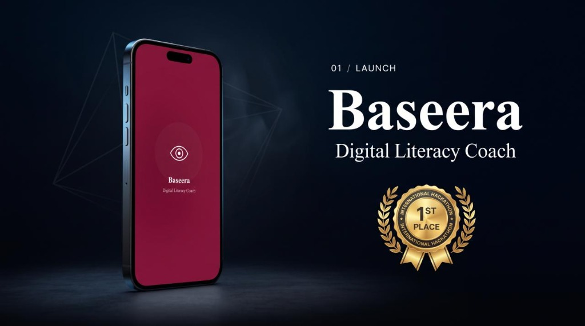
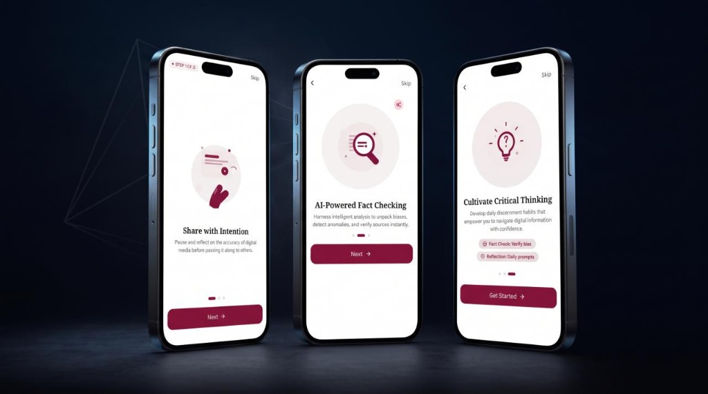
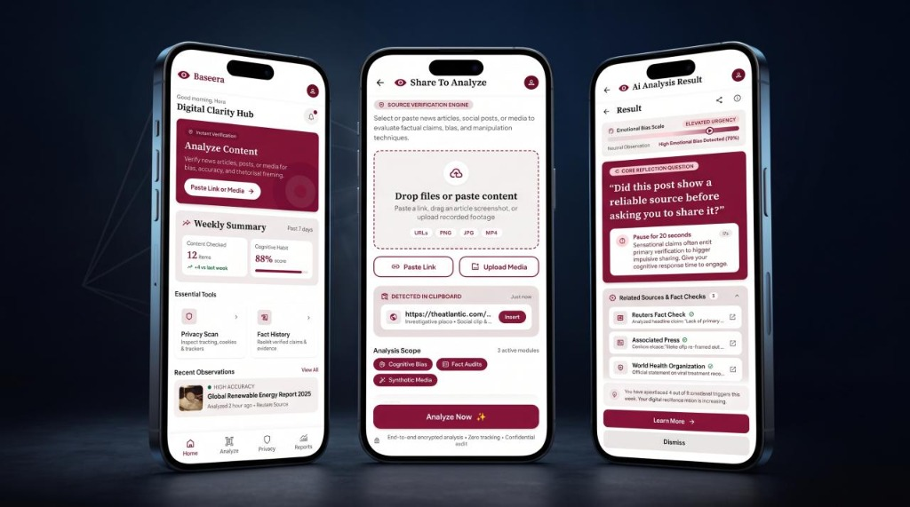

# Baseera — Digital Literacy Evaluation Platform

Baseera is an evaluation platform and mobile application developed for the **Erasmus+ VirtuallyEDU** initiative. It prompts users to pause, evaluate emotional framing, and critically assess digital content before sharing online.

---

## Overview

The application analyzes user-submitted text and images for emotional bias, urgency manipulation, and framing patterns. Rather than classifying content as strictly "true" or "false", Baseera delivers Socratic reflection questions and references established media verification organizations (such as Reuters, Snopes, AP, and PolitiFact) to foster critical discernment.

---

## Core Features

- **Multimodal Evaluation**: Analyzes text submissions and image files for framing and emotional bias.
- **Socratic Reflection Prompts**: Generates context-specific questions that prompt critical evaluation.
- **Cognitive Bias Metric**: Displays a calibrated 0–100 scale indicating urgency and emotional loading.
- **Verification References**: Cites established independent fact-checking and media evaluation entities.
- **Local Observation Ledger**: Stores evaluation history locally in the browser/client without external tracking.
- **LiteLLM Gateway Compatibility**: Integrates through a centralized AI infrastructure layer supporting LiteLLM proxies and OpenAI-compatible endpoints.

---

## Interface Showcase & Live Demo

### Launch Screen — Baseera Digital Literacy Coach

The welcoming splash screen setting the stage for a secure, intelligent, and mindful digital experience. It features a premium, minimalist design that reflects the award-winning nature of the platform.



---

### Share with Intention + AI-Powered Fact Checking + Cultivate Critical Thinking

- **Share with Intention**: Pause and reflect on the accuracy of digital media before passing it along to others.
- **AI-Powered Fact Checking**: Harness intelligent analysis to unpack biases, detect anomalies, and verify sources instantly.
- **Cultivate Critical Thinking**: Develop daily discernment habits that empower you to navigate digital information with confidence.



---

### Digital Clarity Hub + Share To Analyze + AI Analysis Result

- **Digital Clarity Hub**: Analyze content for bias and accuracy, and track your weekly activity with interactive stats and essential tools like Privacy Scan and Fact History.
- **Share To Analyze**: Upload or paste links, articles, or media to evaluate factual claims and detect manipulation techniques, backed by advanced verification protocols.
- **AI Analysis Result**: Discover emotional bias levels, explore critical reflection questions, and review verified related sources to strengthen your digital resilience.



---

### QR CODE Demo

Scan this QR code with any mobile device to download the standalone Android application package (`baseera.apk`) or test via the responsive web application:

<p align="center">
  
</p>

- **Direct APK Download**: [mediafire.com/file/ppu23zjxboczhhf/baseera.apk/file](https://www.mediafire.com/file/ppu23zjxboczhhf/baseera.apk/file)
- **Instant Guest Testing**: Launch the app and select **Continue as Guest** to evaluate features without registration.

---

## Technology Stack

| Layer | Technology | Purpose |
|---|---|---|
| Language | TypeScript 5+ | Type safety and domain contracts |
| UI Framework | React 19 | Component hierarchy and state rendering |
| Routing | React Router 7 | Client-side view routing |
| Styling | Tailwind CSS 3 | Utility layout and restrained design system |
| Build Tool | Vite 8 | Fast development bundling and compilation |
| AI Integration | LiteLLM / OpenAI Gateway | Centralized LLM routing and inference |
| Mobile Shell | Capacitor 8 | Android WebView deployment target |
| Test Runner | Vitest 5 | Unit and integration test execution |
| Linter | Oxlint 1.8+ | High-performance static analysis |

---

## Architecture

The client application operates as a single-page application (SPA) with in-memory session management and client persistence:

```
[Browser / Android WebView]
           │
     React 19 Shell
     (Routes, App)
      │          │
   Screens    Services
      │          │
      ▼          ▼
  Store.ts   AuthService
      │          │
      ▼          ▼
 localStorage  AIProvider (LiteLLM Proxy / Direct Gateway)
                     │
                     ▼
             [LLM Inference]
```

### AI Service Layer (`src/services/aiProvider.ts`)
LLM inference requests pass through a centralized infrastructure service. The service formats multimodal payloads, enforces strict JSON response validation, strips reasoning tokens (such as Qwen `<think>` blocks), and provides deterministic fallback responses if connectivity fails.

---

## Prerequisites

- **Node.js**: `v20.x` or higher
- **npm**: `v10.x` or higher
- **Optional**: Python 3.10+ (for running a local LiteLLM proxy instance)

---

## Installation & Setup

1. **Clone the repository**:
   ```bash
   git clone https://github.com/benoualiabdelkader/VirtuallyEDU-Erasmus-Project.git
   cd VirtuallyEDU-Erasmus-Project/baseera
   ```

2. **Install project dependencies**:
   ```bash
   npm install
   ```

3. **Configure environment variables**:
   Create a local `.env` file based on `.env.example`:
   ```bash
   cp .env.example .env
   ```

   Update the values in `.env`:
   ```ini
   VITE_AI_BASE_URL=https://api.groq.com/openai/v1
   VITE_AI_API_KEY=your_api_key_here
   VITE_AI_MODEL=qwen/qwen3.8-27b
   ```

---

## Running Locally

### Development Server
```bash
cd baseera
npm run dev
```
The application will be accessible at `http://localhost:5173`.

### Running with LiteLLM Proxy (Recommended for Enterprise / Multi-Model setups)
1. Install LiteLLM:
   ```bash
   pip install litellm
   ```
2. Start the proxy with the provided configuration:
   ```bash
   export GROQ_API_KEY="your_api_key_here"
   litellm --config config/litellm_config.yaml --port 4000
   ```
3. Point `.env` to the proxy:
   ```ini
   VITE_AI_BASE_URL=http://localhost:4000/v1
   VITE_AI_MODEL=baseera-default
   ```

---

## Verification & Testing

Navigate to the `baseera` directory to run verification commands:

```bash
cd baseera
```

### Automated Test Suite
Runs all 49 unit and integration tests across storage, authentication, and AI provider fallback chains:
```bash
npm test
```

### Static Analysis & Linting
Enforces code quality, React Compiler rules, and type discipline:
```bash
npm run lint
```

### Production Build
Verifies TypeScript compilation and creates the production distribution:
```bash
npm run build
```

---

## Android Deployment

The repository includes a configured Capacitor setup for building native Android APKs:

```bash
cd baseera
npm run build
npx cap sync android
npx cap open android
```

---

## License & Attribution

Developed under the **Erasmus+ VirtuallyEDU** project framework.
