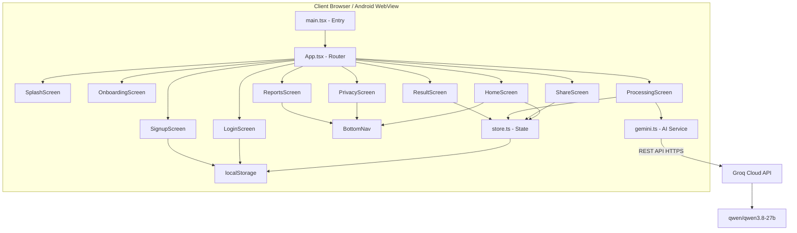
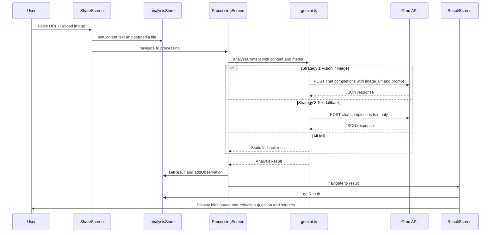
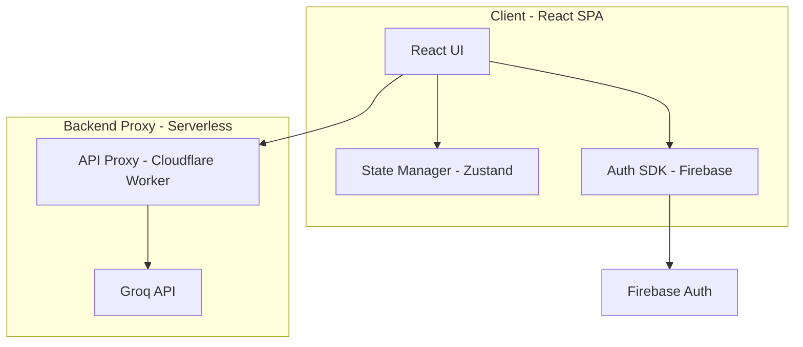

# 🔍 Baseera — Full Project Audit Report

**Audit Date:** 2026-10-13  
**Auditor:** Technical Audit (AI-assisted review with manual source verification)  
**Project Version:** 0.0.0 (pre-release / hackathon MVP)  
**Report Language:** English (code identifiers preserved)

---

## 1. Executive Summary

### What This Project Is

**Baseera** ("بصيرة" — meaning "insight/vision" in Arabic) is an AI-powered **Digital Literacy Coach** mobile/web application. It was built for the **Erasmus+ VirtuallyEdu Digital Hackathon** by an international 5-person student team (Algeria, Armenia, Greece, Ukraine, Georgia). The app helps users critically evaluate online content before sharing it, using AI to detect emotional bias, urgency manipulation, and privacy risks.

### Current State: **Working MVP with Significant Caveats**

The application runs, builds, and all 49 tests pass. However, it has critical security issues and architectural limitations that prevent production deployment.

### 🏆 Top 5 Most Important Findings

| # | Finding | Severity | Evidence |
|---|---------|----------|----------|
| 1 | **[VERIFIED] API keys are hardcoded in `.env` AND in root-level test scripts** — both Gemini and Groq keys are exposed in plaintext in committed files | 🔴 Critical | `.env:1-2`, `test_gemini.cjs:2`, `test_groq.cjs:1` |
| 2 | **[VERIFIED] Passwords stored in plaintext in localStorage** — the mock auth system stores raw passwords without any hashing | 🔴 Critical | `SignupScreen.tsx:41`, `LoginScreen.tsx:25` |
| 3 | **[VERIFIED] Privacy features are entirely simulated** — the "Privacy Shield" screen uses hardcoded mock data, no actual face detection or EXIF stripping occurs | 🟡 Medium | `PrivacyScreen.tsx:5-9` |
| 4 | **[VERIFIED] Weekly statistics are hardcoded, not computed** — the "88% Habit Score", "12 items", and all Reports data are static values | 🟡 Medium | `HomeScreen.tsx:104,116`, `ReportsScreen.tsx:13-36` |
| 5 | **[VERIFIED] The app claims "280+ peer-reviewed archives" and "end-to-end encryption" — neither is true** — these are marketing claims in the UI with zero implementation | 🟠 High | `ShareScreen.tsx:390,408`, `ProcessingScreen.tsx:196` |

---

## 2. Project Identity

| Property | Value |
|----------|-------|
| **Name** | Baseera (بصيرة) |
| **Purpose** | AI-powered digital literacy coach — helps users pause, reflect, and think critically before sharing online content |
| **Target Users** | General public, students, educators (primarily for hackathon demo) |
| **Problem Solved** | Impulsive sharing of misinformation on social media |
| **Platforms** | Web (SPA) + Android (via Capacitor) |
| **Repo Size** | ~6 MB APK + ~180 KB source (excluding node_modules) |
| **Languages** | TypeScript/TSX (~95%), CSS (~3%), HTML (~1%), Python (~1% - PDF generators) |
| **Context** | Erasmus+ VirtuallyEdu Digital Hackathon submission |
| **Team** | 5 members — Abdelkader (Algeria, Lead), Azatuhi (Armenia), Fotini (Greece), Anastasia (Ukraine), Milena (Georgia) |
| **Last Activity** | Active as of audit date |
| **Motto** | "Teaching minds to doubt, not machines to decide." |

---

## 3. Technology Stack

| Layer | Technology | Version | Purpose | Where Used | Notes |
|-------|-----------|---------|---------|------------|-------|
| Language | TypeScript | ~6.0.2 | Type-safe JavaScript | All `src/` files | Modern ES2023 target |
| UI Framework | React | ^19.2.8 | Component-based UI | All `.tsx` files | React 19 — latest |
| Routing | react-router-dom | ^7.18.4 | Client-side navigation | `App.tsx`, all screens | v7 — latest |
| Charts | Recharts | ^3.10.1 | Bar charts in Reports | `ReportsScreen.tsx` | Only used in one screen |
| Build Tool | Vite | ^8.3.0 | Dev server + bundler | `vite.config.ts` | Modern, fast |
| Styling | TailwindCSS | ^3.4.19 | Utility-first CSS | All components | v3, not v4 |
| PostCSS | postcss + autoprefixer | ^8.5.28 | CSS processing | `postcss.config.js` | Standard setup |
| Mobile Shell | Capacitor | ^8.5.2 | Android APK packaging | `capacitor.config.ts`, `android/` | Wraps web app in WebView |
| AI Provider | Groq Cloud | REST API | LLM inference | `src/services/gemini.ts` | Uses `qwen/qwen3.8-27b` model |
| AI SDK (unused) | @google/generative-ai | ^0.24.1 | Gemini API client | Root test scripts only | ⚠️ **Not used in app** — only in `test_gemini*.cjs` |
| Testing | Vitest | ^5.0.2 | Unit + integration tests | `src/test/` | With JSDOM environment |
| Test Utilities | @testing-library/react | ^16.3.3 | React component testing | `auth.test.tsx` | Standard |
| Linting | OxLint | ^1.81.0 | Fast linter | `.oxlintrc.json` | React + TS plugins enabled |
| Fonts | Google Fonts (remote) | N/A | Typography | `index.html`, `index.css` | Plus Jakarta Sans + Noto Serif |
| Icons | Material Symbols Outlined | N/A | Icon system | All screens | Loaded from Google CDN |

---

## 4. Architecture

### 4.1 High-Level Description

Baseera is a **single-page application (SPA)** built with React and TypeScript. It follows a simple flat architecture with no backend server — all state management uses either in-memory module singletons or browser `localStorage`. AI analysis is performed client-side via direct REST calls to the Groq Cloud API.

**In plain language:** When a user submits content (text or image), the app sends it directly from the browser to Groq's API, gets back a JSON response with bias analysis, and displays it. There is no server, no database, and no real authentication — it's a purely client-side application wrapped in a native Android shell via Capacitor.

### 4.2 Component Diagram



### 4.3 Main Data Flow — Content Analysis Journey



### 4.4 Layering and Boundaries

| Concern | Location | Coupling |
|---------|----------|----------|
| Routing and Auth Guard | `App.tsx` | Tightly coupled — `ProtectedRoute` defined inline inside render |
| State Management | `store.ts` | Module singleton — simple but global, no reactivity |
| AI Service | `services/gemini.ts` | Well-isolated, single export function |
| UI Screens | `screens/*.tsx` | Each screen is self-contained but shares styling patterns |
| Shared Components | `components/BottomNav.tsx` | Only one reusable component exists |
| Persistence | `localStorage` | Scattered across multiple screens — no centralized data layer |

**Key observation:** Business logic (analysis, observation management) lives in `store.ts` and `gemini.ts`. UI logic is spread across screen files. There is no service layer, no API abstraction, and no state management library — appropriate for a hackathon MVP but not for production.

---

## 5. Directory and File Guide

| Path | Role | Key Contents | Complexity | Understanding Risk |
|------|------|-------------|------------|-------------------|
| `src/main.tsx` | App bootstrap | React DOM render | Low | Low |
| `src/App.tsx` | Router + auth guard | All routes, protected route wrapper, auth state | Medium | **High** — auth logic intertwined with routing |
| `src/store.ts` | State management | In-memory singleton + localStorage observations | Medium | Medium |
| `src/services/gemini.ts` | AI service | Groq API calls, prompt, parsing, fallback chain | **High** | **High** — core AI logic, prompt engineering |
| `src/components/BottomNav.tsx` | Navigation bar | Tab navigation component | Low | Low |
| `src/screens/SplashScreen.tsx` | Boot screen | 2.2s splash with auto-redirect | Low | Low |
| `src/screens/OnboardingScreen.tsx` | Tutorial slides | 3-slide carousel with SVG illustrations | Low | Low |
| `src/screens/LoginScreen.tsx` | Login form | Email/password + guest access | Low | Medium — plaintext auth |
| `src/screens/SignupScreen.tsx` | Registration form | Name/email/password with validation | Low | Medium — plaintext storage |
| `src/screens/HomeScreen.tsx` | Main dashboard | Greeting, hero CTA, weekly stats, recent observations | Medium | Medium |
| `src/screens/ShareScreen.tsx` | Content input | URL/file upload, drag and drop, clipboard, scope tags | **High** | **High** — complex interaction logic |
| `src/screens/ProcessingScreen.tsx` | Loading screen | Animated progress ring, API call orchestration | Medium | **High** — API call + animation coupling |
| `src/screens/ResultScreen.tsx` | Analysis results | Bias gauge, Socratic question, 20s pause timer, sources | **High** | **High** — core value proposition |
| `src/screens/PrivacyScreen.tsx` | Privacy inspector | Mock detection overlays on fake image | Medium | Medium — entirely simulated |
| `src/screens/ReportsScreen.tsx` | Weekly reports | Charts (Recharts), static stats | Medium | Low — all data hardcoded |
| `src/index.css` | Global styles | Tailwind directives, component classes, animations | Medium | Low |
| `tailwind.config.js` | Design system | Material Design 3 color tokens, typography scale | Medium | Medium — custom design system |
| `index.html` | HTML shell | Meta tags, fonts, viewport config | Low | Low |
| `.env` | Secrets | API keys (Gemini + Groq) | Low | **Critical** — contains live keys |
| `test_gemini.cjs` | Dev exploration | Gemini API test script with hardcoded key | Low | Low — not part of app |
| `test_groq.cjs` | Dev exploration | Groq model availability test | Low | Low — not part of app |
| `capacitor.config.ts` | Mobile config | App ID, name, web directory | Low | Low |
| `docs/baseera_system_architecture.tex` | Documentation | LaTeX system architecture document | Low | Low |
| `Baseera_Presentation_Guide.txt` | Presentation | Full hackathon pitch script with speaker notes | Low | Helpful for understanding intent |

---

## 6. Feature Inventory

| Feature | Description | Files Involved | Status | Tests? | Notes |
|---------|-------------|----------------|--------|--------|-------|
| Splash Screen | Animated 2.2s brand intro with auto-redirect | `SplashScreen.tsx` | ✅ Working | No | Redirects based on onboarding/auth state |
| Onboarding | 3-slide tutorial explaining app philosophy | `OnboardingScreen.tsx` | ✅ Working | No | Can skip; sets localStorage flag |
| Sign Up | Email/password registration | `SignupScreen.tsx` | ✅ Working | ✅ 6 tests | ⚠️ Passwords stored in plaintext localStorage |
| Login | Email/password authentication | `LoginScreen.tsx` | ✅ Working | ✅ 7 tests | ⚠️ Plaintext password comparison |
| Guest Access | One-click guest login with full access | `LoginScreen.tsx`, `SignupScreen.tsx` | ✅ Working | ✅ 2 tests | Creates guest user in localStorage |
| Content Input | Paste URL, upload file, drag and drop, clipboard detect | `ShareScreen.tsx` | ✅ Working | No | Supports images, text, paste |
| Analysis Scope Tags | Toggle Cognitive Bias / Fact Audits / Synthetic Media modules | `ShareScreen.tsx:5-9` | ⚠️ **Stub** | No | UI exists but tags are **not sent to AI** |
| AI Content Analysis | Send text/image to Groq for bias analysis | `gemini.ts` | ✅ Working | ✅ 20 tests | 3-strategy fallback chain |
| Processing Animation | Animated progress ring with cycling status messages | `ProcessingScreen.tsx` | ✅ Working | No | Progress is cosmetic, not tied to real progress |
| Bias Gauge | Visual 0-100% bias meter with color coding | `ResultScreen.tsx` | ✅ Working | No | Color-coded green/amber/red |
| Socratic Reflection Question | AI-generated question to prompt critical thinking | `ResultScreen.tsx` | ✅ Working | No | Core differentiator |
| 20-Second Pause Timer | Countdown timer forcing user to pause before dismissing | `ResultScreen.tsx` | ✅ Working | No | Timer is cosmetic — no enforcement |
| Source References | Collapsible list of fact-check organizations | `ResultScreen.tsx` | ✅ Working | No | ⚠️ Sources are AI-generated, not verified |
| Observation History | Saves past analyses to localStorage | `store.ts`, `HomeScreen.tsx` | ✅ Working | ✅ 4 tests | Limited to 20 most recent |
| Privacy Inspection | Detect faces, GPS, personal text in images | `PrivacyScreen.tsx` | ❌ **Simulated** | No | All detections are hardcoded mock data |
| Weekly Reports | Charts and statistics about user behavior | `ReportsScreen.tsx` | ❌ **Hardcoded** | No | All data is static — not computed from actual usage |
| Logout | Clear session and redirect to login | `App.tsx`, `HomeScreen.tsx` | ✅ Working | No | Removes `baseera_user` from localStorage |
| Protected Routes | Auth guard wrapper for authenticated screens | `App.tsx:42-47` | ✅ Working | No | ⚠️ Defined inline (lint warning) |
| PWA Manifest | Web app manifest for potential installation | `manifest.webmanifest` | ⚠️ Partial | No | Missing `name`, `start_url`, `display` fields |
| Notifications Button | Bell icon with red dot badge in header | `HomeScreen.tsx:56-62` | ❌ **Stub** | No | Visual only — no functionality |
| Share/Info Buttons | Share and info icons on Result screen | `ResultScreen.tsx:66-71` | ❌ **Stub** | No | Visual only — no functionality |
| Clipboard Detection Card | Shows a hardcoded Atlantic URL as sample | `ShareScreen.tsx:20,317-346` | ⚠️ **Fake** | No | Not actual clipboard detection — hardcoded URL |
| Truth Protocol Banner | Claims "280+ peer-reviewed archives" | `ShareScreen.tsx:376-392` | ❌ **Marketing** | No | No such archives exist in the codebase |

---

## 7. User Experience Analysis

### 7.1 Screens/Routes Inventory

| Route | Screen | Purpose | Components Used | Data Source | States Handled |
|-------|--------|---------|-----------------|-------------|----------------|
| `/` | SplashScreen | Brand intro + redirect | — | localStorage | Loading then redirect |
| `/onboarding` | OnboardingScreen | First-time user tutorial | — | — | Slide navigation |
| `/login` | LoginScreen | Authentication | — | localStorage | Empty, error, guest |
| `/signup` | SignupScreen | Registration | — | localStorage | Empty, validation errors |
| `/home` | HomeScreen | Main dashboard | BottomNav | localStorage, store | With/without observations |
| `/share` | ShareScreen | Content input | — | store | Empty, file uploaded, URL pasted, dragging |
| `/processing` | ProcessingScreen | AI analysis loading | — | store, Groq API | Loading, error |
| `/result` | ResultScreen | Analysis results | — | store | Full result, fallback result |
| `/privacy` | PrivacyScreen | Privacy inspection | BottomNav | hardcoded | Risks detected, risks mitigated |
| `/reports` | ReportsScreen | Weekly statistics | BottomNav, Recharts | hardcoded | No dynamic states |

### 7.2 Main User Journeys

**Happy Path (New User):**
1. Launch → Splash (2.2s) → Onboarding (3 slides) → Signup → Home
2. Home → "Paste Link or Media" → ShareScreen → Paste/upload content → "Analyze Now"
3. ProcessingScreen (3-5s animation) → ResultScreen (bias gauge, Socratic question, 20s timer)
4. After 20s → "Learn More" or "Dismiss" → Home

**Returning User:**
1. Launch → Splash → Home (if already logged in)
2. View recent observations on Home → Click to re-view past result

**Guest User:**
1. Launch → Splash → Login → "Continue as Guest" → Home (full access)

### 7.3 UI States Coverage

| State | Splash | Onboarding | Login | Share | Processing | Result | Privacy | Reports |
|-------|:------:|:----------:|:-----:|:-----:|:----------:|:------:|:-------:|:-------:|
| Loading | ✅ | — | — | — | ✅ | — | — | — |
| Empty | — | — | ✅ | ✅ | — | — | — | — |
| Error | — | — | ✅ | — | ✅ | — | — | — |
| Success | — | — | — | ✅ | — | ✅ | ✅ | — |
| Offline | ❌ | ❌ | ❌ | ❌ | ❌ | ❌ | ❌ | ❌ |

**[VERIFIED] No offline handling exists anywhere.** The app will silently fail if used without network connectivity. [VERIFIED] in `gemini.ts` — no offline detection, just a generic error fallback.

### 7.4 Accessibility, RTL, i18n, Responsiveness

- **Accessibility:** Partial. `aria-label` attributes exist on navigation buttons and some interactive elements. The SplashScreen has `sr-only` text. However, no ARIA live regions for dynamic content updates, no focus management on route changes, no skip navigation links.
- **RTL/i18n:** ❌ Not implemented. All content is English-only. No i18n framework. The app name "Baseera" is Arabic, but the interface has zero Arabic support or RTL layout.
- **Responsiveness:** The app uses a fixed `max-width: 480px` mobile shell (`index.css:46`), centering it on desktop. This is intentional — it is designed as a mobile-first app. Works well on mobile viewports.
- **Performance Perception:** Good. Animations (fade-in, slide-up, progress ring) create a polished feel. The 20-second pause timer is genuinely engaging.
- **Input Validation:** Basic. Signup validates email format and password length (6+ chars). No server-side validation exists.

### 7.5 UX Problems and Quick Wins

| Priority | Problem | Quick Win |
|----------|---------|-----------|
| 🔴 High | "Analyze Now" works even with empty input — sends "Generic social media post" to AI | Disable button until content is provided |
| 🔴 High | "Detected in Clipboard" card shows a hardcoded URL, not actual clipboard | Remove or implement actual clipboard API |
| 🟡 Medium | 20s pause timer has no enforcement — user can scroll and interact freely | Consider dimming action buttons during countdown |
| 🟡 Medium | "Learn More" button on ResultScreen just navigates to Home | Link to actual educational resource |
| 🟡 Medium | No feedback when API is slow (>25s timeout) | Add retry button visible during long waits |
| 🟢 Low | Source links ("Open in new tab" icons) don't link anywhere | Add actual URLs for fact-check orgs |
| 🟢 Low | Reports screen hardcoded date "Sept 20 - Sept 26, 2026" | Compute from actual date |

---

## 8. Data Layer

### 8.1 Data Models / Schemas

| Entity | Fields | Types | Relations | Defined In |
|--------|--------|-------|-----------|------------|
| `AnalysisResult` | reflectionQuestion, biasLevel, biasLabel, urgencyTag, insight, sources[], weeklyCount, weeklyTotal, _model? | string, number, string, string, string, Source[], number, number, string? | — | `gemini.ts:23-33` |
| `Source` | name, icon, finding | string, string, string | Part of AnalysisResult | `gemini.ts:29` |
| `MediaAttachment` | name, type, size, previewUrl?, base64? | string, string, number, string?, string? | Part of Observation | `store.ts:7-13` |
| `Observation` | id, title, tag, tagColor, time, timestamp, source, img?, result, content, media? | string, string, string, string, string, number, string, string?, AnalysisResult, string, MediaAttachment? | Contains AnalysisResult | `store.ts:15-27` |
| User (implicit) | name, email, password?, isGuest?, createdAt? | string, string, string?, boolean?, string? | — | `LoginScreen.tsx:37-42`, `SignupScreen.tsx:41` |

### 8.2 Storage

| Storage | What | Where Read | Max Size | Validation |
|---------|------|------------|----------|------------|
| `localStorage['baseera_user']` | Current user JSON | `App.tsx:29`, `HomeScreen.tsx:17` | ~1 KB | None |
| `localStorage['baseera_users']` | All registered users array | `LoginScreen.tsx:24`, `SignupScreen.tsx:33` | Unbounded | None |
| `localStorage['baseera_onboarded']` | Onboarding completion flag | `App.tsx:26`, `SplashScreen.tsx:9` | 4 bytes | None |
| `localStorage['baseera_cleared_v1']` | Migration flag | `App.tsx:20` | 4 bytes | None |
| `localStorage['baseera_observations']` | Analysis history JSON | `store.ts:45,61` | ~200 KB (20 obs x ~10 KB) | try/catch only |
| In-memory singleton | Current analysis content, media, result | `store.ts:29-31` | Unlimited | None |

**[VERIFIED] Privacy-sensitive data:**
- Passwords are stored in plaintext in `baseera_users`
- Base64-encoded images may be stored in `baseera_observations` (via `media.base64` and observation `img` field)
- No encryption, no expiry, no size limits

---

## 9. API and Integrations

### 9.1 Internal Endpoints

**None.** [VERIFIED] There is no backend server. The app is entirely client-side.

### 9.2 External Services

| Service | Purpose | Auth Method | Error Handling | Fallback | Cost/Rate-Limit Risk |
|---------|---------|-------------|----------------|----------|----------------------|
| **Groq Cloud API** (`api.groq.com/openai/v1/chat/completions`) | LLM inference for content analysis | Bearer token (API key in env var) | 25s timeout, catch then static fallback | 3-strategy chain + hardcoded fallback | ⚠️ Free tier has rate limits; key is shared |
| **Google Fonts CDN** (`fonts.googleapis.com`) | Typography loading | None | None (fonts fail silently) | System fonts | Low |
| **Google Material Symbols CDN** | Icon loading | None | None | Icons show text fallback | Low |

---

## 10. AI / LLM Components

### 10.1 Models and Providers

| Provider | Model | Where Used | Purpose |
|----------|-------|------------|---------|
| **Groq Cloud** | `qwen/qwen3.8-27b` | `gemini.ts:19` | Primary: text analysis + image vision + JSON mode |
| **Groq Cloud** | `openai/gpt-oss-120b` | `gemini.ts:7` (comment only) | Mentioned as text fallback but **never called in code** |
| **Google Gemini** | Various | `test_gemini.cjs` only | Dev exploration scripts only — **not used in app** |

**[VERIFIED] Naming confusion:** The service file is named `gemini.ts` but it actually calls the **Groq** API, not Google Gemini. The file header comments explain this but the filename is misleading.

### 10.2 Prompts

**Single prompt** defined at `gemini.ts:112-148` in the `buildPrompt()` function:

- **Location:** `src/services/gemini.ts`, lines 112-148
- **Purpose:** Analyze content for emotional bias, urgency, and source credibility
- **System role:** "You are Baseera, an AI-powered digital literacy coach"
- **Key instruction:** "Help users think critically — do NOT label content true or false"
- **Input:** User's content (text and/or image context)
- **Output format:** Strict JSON with 8 fields
- **Rules:** Content-specific question, real fact-check orgs, weeklyTotal > weeklyCount

**[VERIFIED] Prompt observations:**
1. The prompt asks the LLM to generate `weeklyCount` and `weeklyTotal` as random numbers (5-10 and 10-15) — these are meaningless but displayed as "real" stats to the user
2. The prompt tells the LLM to use specific fact-check org names (Snopes, PolitiFact, etc.) — the AI generates findings but does not actually query these services
3. For images: the prompt says "Carefully examine its visual content" but actual vision capability depends on the model supporting it

### 10.3 Structured Output Handling

**[VERIFIED]** Well-implemented in `parseResponse()` at `gemini.ts:153-174`:
- Strips markdown code fences
- Strips Qwen think-tokens (`<think>...</think>`)
- Validates required fields (`reflectionQuestion`, `biasLevel`)
- Clamps `biasLevel` to 0-100
- Falls back to `FALLBACK_SOURCES` if sources are empty/null

### 10.4 Fallback Chain

```
Strategy 1 (Vision): qwen3.8-27b with image_url → if fails →
Strategy 2 (Text):   qwen3.8-27b text-only with context → if fails →
Strategy 3 (Static): Hardcoded fallback with random values
```

**[VERIFIED]** The static fallback (`buildFallback()` at `gemini.ts:52-65`) generates random bias levels (45-80) and picks random reflection questions. The `_model` field marks fallback results as `fallback:reason`, which is displayed on the ResultScreen as "Demo Mode."

### 10.5 AI Quality Evaluation

**[VERIFIED] There is NO measurement of AI quality.** No evaluation framework, no ground truth dataset, no A/B testing, no user feedback collection on AI output quality.

**Proposed minimal eval design:**
1. Create a test corpus of 20-30 articles with known bias levels (from fact-check databases)
2. Run each through `analyzeContent()` and compare `biasLevel` to expected range
3. Evaluate `reflectionQuestion` quality: is it content-specific? Socratic? Under 30 words?
4. Track fallback rate in production to measure API reliability
5. Add optional "Was this helpful?" button on ResultScreen to collect user feedback

### 10.6 AI Risks

| Risk | Severity | Evidence |
|------|----------|----------|
| **Prompt injection** | 🟡 Medium | User content is inserted directly into the prompt without sanitization (`gemini.ts:125`). A crafted input could manipulate the AI output. |
| **Hallucinated sources** | 🔴 High | The AI generates fact-check "findings" that look authoritative but are fabricated. Users may trust "Snopes: Claim unverified" as real. |
| **Cost** | 🟡 Medium | Groq free tier has rate limits. No per-user rate limiting. A single user could exhaust the shared API key. |
| **Privacy** | 🟠 High | User content (including images as base64) is sent to Groq API. The app claims "Zero data retained" — this depends entirely on Groq policy, not the app. |
| **Latency** | 🟢 Low | 25s timeout is generous. The progress animation masks actual latency well. |

---

## 11. Configuration, Environment and Secrets

### 11.1 Environment Variables

| Name | Purpose | Required? | Where Read | Default |
|------|---------|-----------|------------|---------|
| `VITE_GEMINI_API_KEY` | Google Gemini API key | No (unused in app) | `.env` only | None |
| `VITE_GROQ_API_KEY` | Groq Cloud API key | **Yes** | `gemini.ts:15` via `import.meta.env` | None — falls back to static results |

### 11.2 Hardcoded Secrets

> **CAUTION: Multiple API keys are hardcoded in committed files.**

| File | Line | Secret Type | Value (Masked) |
|------|------|-------------|----------------|
| `.env` | 1 | Gemini API key | `AQ.Ab8R...***` |
| `.env` | 2 | Groq API key | `gsk_kTja...***` |
| `test_gemini.cjs` | 2 | Gemini API key | `AQ.Ab8R...***` (different key!) |
| `test_groq.cjs` | 1 | Groq API key | `gsk_kTja...***` (same as .env) |
| `test_gemini2.cjs` | (present) | Likely contains keys | Not fully reviewed |
| `test_groq2.cjs` | (present) | Likely contains keys | Not fully reviewed |

**[VERIFIED]** The `.gitignore` does list `.env`, but the `test_*.cjs` files contain hardcoded keys and are NOT gitignored. If this repo is ever made public, all keys will be exposed.

### 11.3 Dev vs. Prod Differences

**[VERIFIED] There is no distinction between dev and prod.** The same `.env` file and same API keys are used everywhere. The `VITE_` prefix means these keys are embedded in the client-side JavaScript bundle — they are visible to any user who opens browser DevTools.

---

## 12. Security Review

| ID | Severity | Category | Description | Evidence | Recommended Fix |
|----|----------|----------|-------------|----------|-----------------|
| SEC-01 | 🔴 Critical | Secrets | API keys hardcoded in source files (`test_*.cjs`) | `test_gemini.cjs:2`, `test_groq.cjs:1` | Move all keys to `.env`, add `test_*.cjs` to `.gitignore`, rotate all exposed keys immediately |
| SEC-02 | 🔴 Critical | Secrets | Client-side API key exposure — `VITE_` prefix embeds keys in JS bundle | `gemini.ts:15` | Use a backend proxy to call Groq API; never expose API keys to the browser |
| SEC-03 | 🔴 Critical | Auth | Passwords stored in plaintext in localStorage | `SignupScreen.tsx:41` — `{ name, email, password }` stored as JSON | Hash passwords before storage (bcrypt/argon2), or use a real auth provider |
| SEC-04 | 🔴 Critical | Auth | Password comparison in plaintext | `LoginScreen.tsx:25` — `u.password === password` | Implement proper credential verification |
| SEC-05 | 🟠 High | Privacy | App claims "End-to-end encrypted / Zero tracking" with no implementation | `ShareScreen.tsx:408` | Remove false claims, or implement actual encryption |
| SEC-06 | 🟠 High | Privacy | User-uploaded images (as base64) sent to third-party API (Groq) | `gemini.ts:192-194` | Inform users explicitly; add consent dialog |
| SEC-07 | 🟡 Medium | Input | No sanitization of user content before API call — prompt injection risk | `gemini.ts:125` | Sanitize/escape special characters; add input length limits |
| SEC-08 | 🟡 Medium | Auth | No session expiry — once logged in, stays logged in forever | `App.tsx:29` — checks existence of `baseera_user`, never expires | Add session timeout |
| SEC-09 | 🟡 Medium | Data | localStorage has no size limits for observations — could fill storage | `store.ts:60` — slices to 20 but each can be ~10KB with base64 images | Cap image storage size; compress or remove base64 from history |
| SEC-10 | 🟢 Low | CORS | No CORS concerns — all API calls go to Groq public endpoint | — | N/A for current architecture |

---

## 13. Testing and Quality

### 13.1 Test Results

```
✅ All 49 tests pass (3 test files)
- src/test/gemini.test.ts: 20 tests (AI service)
- src/test/store.test.ts:  16 tests (state management)
- src/test/auth.test.tsx:  13 tests (login/signup UI)
Duration: 30.28s
```

### 13.2 Test Coverage Assessment

| Area | Covered? | Depth | Notes |
|------|----------|-------|-------|
| AI Service (`gemini.ts`) | ✅ Yes | **Good** — 20 tests covering happy path, all fallback strategies, edge cases | All fetch calls mocked |
| Store (`store.ts`) | ✅ Yes | **Good** — 16 tests covering content, media, result, observations, clear | localStorage mocked via JSDOM |
| Auth (Login/Signup) | ✅ Yes | **Good** — 13 tests covering rendering, validation, guest mode | Integration tests with React Testing Library |
| SplashScreen | ❌ No | — | Auto-redirect logic untested |
| OnboardingScreen | ❌ No | — | Slide navigation untested |
| HomeScreen | ❌ No | — | Observation rendering untested |
| ShareScreen | ❌ No | — | Complex interaction logic (drag/drop, paste, file upload) untested |
| ProcessingScreen | ❌ No | — | API orchestration + animation untested |
| ResultScreen | ❌ No | — | Core value screen untested |
| PrivacyScreen | ❌ No | — | Mock interactions untested |
| ReportsScreen | ❌ No | — | Chart rendering untested |
| BottomNav | ❌ No | — | Navigation behavior untested |

**Estimated coverage:** ~35-40% of business logic, ~20% of UI screens.

### 13.3 Lint Results

**OxLint output:** 1,841 warnings and 35 errors.

**Key errors (not just warnings):**
1. `ProtectedRoute` component created inside render function (`App.tsx:42`) — causes state reset on each render
2. `useState` called inside `useEffect` in multiple screens — causes cascading renders
3. Missing dependencies in `useEffect` dependency array (`ProcessingScreen.tsx:102`)
4. Unused imports (`beforeEach` in `gemini.test.ts`, `setMockUser` in `auth.test.tsx`)

### 13.4 Code Quality

- **Consistency:** High — consistent styling patterns, consistent component structure
- **Dead code:** `setMockUser` function in `auth.test.tsx:29` is declared but never used
- **Complexity hotspots:** `ShareScreen.tsx` (417 lines), `ResultScreen.tsx` (288 lines), `gemini.ts` (267 lines)
- **Duplication:** SVG logo icon is duplicated in at least 6 screens — should be extracted to a shared component

---

## 14. Build, Deployment and Operations

### 14.1 Build Steps

| Command | Purpose | Works? |
|---------|---------|--------|
| `npm run dev` | Start dev server (Vite) | ✅ [VERIFIED] |
| `npm run build` | TypeScript check + production build | [UNKNOWN] — not run during audit |
| `npm run lint` | OxLint check | ✅ (exits with code 1 due to errors) |
| `npm run test` | Run Vitest tests | ✅ 49/49 passing |
| `npm run preview` | Preview production build | [UNKNOWN] |

### 14.2 Mobile Build

- **Capacitor config:** `com.baseera.app`, web dir = `dist`
- **Android project:** Present in `android/` directory
- **Pre-built APK:** `baseera.apk` (5.9 MB) is included in the repository root
- **QR code:** `baseera_qrcode.png` links to MediaFire download

### 14.3 CI/CD

**[VERIFIED] No CI/CD exists.** No GitHub Actions, no GitLab CI, no deployment pipeline. The APK was manually built and committed.

### 14.4 Hosting Assumptions

**[INFERRED]** The web app appears designed for static hosting (Vercel, Netlify, or similar). The `dist/` directory is present, suggesting a build has been run. No server requirements exist.

### 14.5 How to Run Locally

```bash
# 1. Clone the repository
# 2. Install dependencies
npm install

# 3. Create .env with API keys (CRITICAL: use your own keys, not the exposed ones)
echo "VITE_GROQ_API_KEY=your_groq_key_here" > .env

# 4. Start dev server
npm run dev

# 5. Open http://localhost:5173 (or the port Vite assigns)
```

---

## 15. Dependencies

| Package | Version | Used In App? | Purpose | Concern |
|---------|---------|:------------:|---------|---------|
| `react` | ^19.2.8 | ✅ | UI framework | None — latest |
| `react-dom` | ^19.2.8 | ✅ | DOM rendering | None — latest |
| `react-router-dom` | ^7.18.4 | ✅ | Client-side routing | None — latest |
| `recharts` | ^3.10.1 | ✅ | Charts in ReportsScreen | Large bundle for one chart — consider lighter alternative |
| `@capacitor/core` | ^8.5.2 | ✅ | Mobile API bridge | None |
| `@google/generative-ai` | ^0.24.1 | ⚠️ **No** | Gemini SDK | **Unused in app** — only in root test scripts. Should be devDependency or removed |
| `@capacitor/android` | ^8.5.2 | ✅ | Android build | None |
| `@capacitor/cli` | ^8.5.2 | ✅ | Capacitor CLI | None |
| `@vitejs/plugin-react` | ^6.1.1 | ✅ | React support for Vite | None |
| `typescript` | ~6.0.2 | ✅ | Type checking | None |
| `vite` | ^8.3.0 | ✅ | Build tool | None |
| `vitest` | ^5.0.2 | ✅ | Test runner | None |
| `@vitest/ui` | ^5.0.2 | ✅ | Test UI dashboard | None |
| `tailwindcss` | ^3.4.19 | ✅ | Utility CSS | v3, not v4 — fine for now |
| `postcss` | ^8.5.28 | ✅ | CSS processing | None |
| `autoprefixer` | ^10.6.1 | ✅ | CSS vendor prefixes | None |
| `oxlint` | ^1.81.0 | ✅ | Linting | None |
| `jsdom` | ^29.1.1 | ✅ | Test DOM environment | None |
| `@testing-library/react` | ^16.3.3 | ✅ | React testing utilities | None |
| `@testing-library/jest-dom` | ^7.0.1 | ✅ | DOM assertions | None |
| `@testing-library/user-event` | ^14.6.7 | ✅ | User interaction simulation | None |
| `@types/react` | ^19.2.18 | ✅ | React type definitions | None |
| `@types/react-dom` | ^19.2.7 | ✅ | ReactDOM type definitions | None |
| `@types/node` | ^24.13.3 | ✅ | Node.js type definitions | None |

**Key finding:** `@google/generative-ai` is listed as a **production dependency** but is only used in root-level test/exploration scripts, not in the actual app. It should be moved to devDependencies or removed.

---

## 16. Performance and Scalability

| Concern | Status | Evidence |
|---------|--------|----------|
| **Large base64 images in localStorage** | 🟡 Risk | `store.ts:60` stores full observation with base64 media. 20 observations x 10KB = ~200KB. Could grow larger with high-res images. |
| **No image compression** | 🟡 Risk | `ShareScreen.tsx:41` reads file as full data URL — no resize or compression before sending to API |
| **Font loading (3 remote resources)** | 🟢 Low | Google Fonts + Material Symbols loaded from CDN. Preconnect hints present. |
| **No code splitting** | 🟢 Low | All screens loaded eagerly. For this app size (~100KB source), not a problem. |
| **API timeout 25s** | 🟢 OK | Reasonable for LLM inference. `AbortController` properly used. |
| **No caching of API responses** | 🟡 Risk | Identical content analyzed twice will make two API calls |
| **Recharts bundle size** | 🟡 Risk | Recharts adds significant bundle weight for a single chart on one screen |
| **Status message cycling every 500ms** | 🟢 Low | `ProcessingScreen.tsx:96` — lightweight DOM update, no performance issue |

---

## 17. Technical Debt Register

| ID | Issue | Impact | Effort | Priority | Suggested Approach |
|----|-------|--------|--------|----------|-------------------|
| TD-01 | API keys exposed in client bundle | Security breach risk | M | 🔴 P1 | Create a lightweight backend proxy (e.g., Cloudflare Worker) |
| TD-02 | Plaintext password storage | User data at risk | M | 🔴 P1 | Implement proper auth (Firebase Auth, Supabase, etc.) |
| TD-03 | `ProtectedRoute` defined inside render | State reset on every render | S | 🟠 P2 | Move to module-level component |
| TD-04 | `gemini.ts` filename misleading | Developer confusion | S | 🟡 P3 | Rename to `ai-service.ts` or `groq.ts` |
| TD-05 | SVG logo duplicated in 6+ screens | Maintenance burden | S | 🟡 P3 | Extract to `BaseeraLogo` component |
| TD-06 | Scope tags UI not connected to AI | Feature appears broken | M | 🟡 P3 | Pass selected scopes to `buildPrompt()` |
| TD-07 | All Reports data hardcoded | Users see fake metrics | L | 🟠 P2 | Compute from actual observation history |
| TD-08 | Privacy screen fully mocked | Feature claim is misleading | L | 🟠 P2 | Implement real EXIF stripping + face detection |
| TD-09 | `@google/generative-ai` as prod dependency | Wasted bundle size | S | 🟡 P3 | Move to devDependencies or remove |
| TD-10 | No offline support | App is unusable without network | L | 🟡 P3 | Add service worker, cache essential assets |
| TD-11 | Multiple `setState` in `useEffect` | Cascading renders, lint errors | S | 🟡 P3 | Use `useSyncExternalStore` or initialize state directly |
| TD-12 | Test scripts with hardcoded keys at root | Keys leak if repo goes public | S | 🔴 P1 | Delete or add to `.gitignore`; rotate keys |
| TD-13 | No error boundary | Unhandled errors crash entire app | M | 🟡 P3 | Add React Error Boundary at App level |
| TD-14 | PWA manifest incomplete | Cannot install as PWA | S | 🟢 P4 | Add `name`, `short_name`, `start_url`, `display` |
| TD-15 | False marketing claims in UI | Trust/credibility issue | S | 🟠 P2 | Replace with honest descriptions |

---

## 18. Understanding Map

### 18.1 The 10 Most Critical Things to Understand

| # | File/Concept | Why It Is Critical | What Breaks If Removed |
|---|-------------|-------------------|----------------------|
| 1 | **`gemini.ts` (AI Service)** | This is the brain of the app. It constructs the prompt, calls Groq, parses the response, and manages the 3-strategy fallback chain. | The entire analysis feature — the core value proposition — stops working. |
| 2 | **`store.ts` (State Singleton)** | This bridges data between screens. Content goes in from ShareScreen, results come out in ResultScreen. | Screens cannot communicate. The processing to result flow breaks. |
| 3 | **`App.tsx` (Router + Auth)** | This defines all routes, the auth guard, and session management. | No navigation works. No protected routes. Auth breaks. |
| 4 | **`tailwind.config.js` (Design System)** | This defines every color, font size, and spacing token. The entire visual design comes from here. | The app becomes unstyled — every class like `bg-primary-container` stops working. |
| 5 | **`ProcessingScreen.tsx` (Orchestrator)** | This is where the actual API call happens. It manages the animation, the API call, saving the observation, and navigating to results. | Content analysis never runs; users get stuck. |
| 6 | **`ResultScreen.tsx` (Core UX)** | This displays the AI output — bias gauge, Socratic question, pause timer, sources. | Users never see their analysis results. |
| 7 | **`ShareScreen.tsx` (Input Hub)** | This handles all input methods — paste, upload, drag and drop, clipboard. It prepares data for analysis. | Users cannot submit content for analysis. |
| 8 | **`index.css` (Component Classes)** | Defines `.btn-primary`, `.card`, `.nav-tab`, `.app-shell` — used everywhere. | All buttons, cards, and navigation break visually. |
| 9 | **`localStorage` patterns** | Auth, onboarding state, and observation history all use specific localStorage keys. | Login breaks, onboarding replays, history disappears. |
| 10 | **The Groq API contract** | The app expects a specific JSON response format from the LLM. | If the model returns unexpected format, parsing fails and enters fallback mode. |

### 18.2 Plain-Language Explanations of Key Components

**`gemini.ts` — The AI Brain:**
This file is responsible for taking whatever the user submitted (a URL, some text, or an image) and asking an AI model to analyze it. It builds a very specific prompt that tells the AI "you are a digital literacy coach" and asks it to return a JSON object with a Socratic question, a bias percentage, and references to fact-check organizations. If the AI call fails (bad network, wrong API key, unparseable response), it has a chain of fallbacks: first try the image vision approach, then try text-only, then just show some pre-written fallback content. This ensures the app never crashes — it always shows something.

**`store.ts` — The Data Messenger:**
Since this app has no backend database, it needs a way to pass data from one screen to another. When the user types a URL on the ShareScreen, that URL needs to reach the ProcessingScreen. When the AI returns results, those results need to reach the ResultScreen. `store.ts` acts as a "mailbox" — a simple module-level variable that any screen can read from or write to. It also saves a history of past analyses to localStorage so they survive page refreshes.

**`App.tsx` — The Traffic Controller:**
This file decides which screen to show based on the URL path. It also checks whether the user is logged in — if not, it redirects them to the login page. The `ProtectedRoute` wrapper is like a bouncer at a club: it checks your credentials before letting you into the main app screens.

**`tailwind.config.js` — The Design Dictionary:**
Every color you see in the app (the deep maroon `#8a1538`, the soft cream `#f0eded`, etc.) is defined here using Material Design 3 naming conventions. When you see `bg-primary-container` in the code, it refers to the maroon color defined in this file. If you wanted to change the entire app's color scheme, this is the only file you would need to modify.

### 18.3 Concepts to Learn

| Concept | Why It Matters Here | Where It Appears | Suggested Learning Resource |
|---------|-------------------|------------------|---------------------------|
| React Router v7 | Defines all navigation and protected routes | `App.tsx`, all `useNavigate()` calls | [React Router docs](https://reactrouter.com/) |
| React `useEffect` lifecycle | Controls when side effects (API calls, localStorage reads) run | Every screen file | [React docs: useEffect](https://react.dev/reference/react/useEffect) |
| Tailwind CSS utility classes | Every visual element uses Tailwind classes | All `.tsx` files | [Tailwind docs](https://tailwindcss.com/docs) |
| Material Design 3 color system | The color palette follows MD3 naming (`primary-container`, `on-surface`, etc.) | `tailwind.config.js` | [Material Design 3: Color](https://m3.material.io/styles/color) |
| OpenAI-compatible REST API | Groq uses the OpenAI chat completions format | `gemini.ts:79-93` | [OpenAI API reference](https://platform.openai.com/docs/api-reference/chat) |
| Prompt engineering | The prompt structure determines AI output quality | `gemini.ts:112-148` | [Prompt Engineering Guide](https://www.promptingguide.ai/) |
| Capacitor (Ionic) | Wraps the web app as a native Android app | `capacitor.config.ts`, `android/` | [Capacitor docs](https://capacitorjs.com/docs) |
| localStorage API | Used for persistence without a backend | `store.ts`, `App.tsx`, auth screens | [MDN: localStorage](https://developer.mozilla.org/en-US/docs/Web/API/Window/localStorage) |
| Vitest testing framework | Runs all unit and integration tests | `src/test/` | [Vitest docs](https://vitest.dev/) |
| AbortController for fetch | Handles API request timeouts | `gemini.ts:74-96` | [MDN: AbortController](https://developer.mozilla.org/en-US/docs/Web/API/AbortController) |

### 18.4 Interview Questions

If you built this project, you should be able to answer:

1. **"Walk me through what happens from the moment a user pastes a URL to seeing the bias result."** (Tests understanding of ShareScreen → store → ProcessingScreen → gemini.ts → ResultScreen flow)

2. **"Why does the app use Groq instead of Gemini, despite the file being named gemini.ts?"** (Tests knowledge of the evolution of the codebase)

3. **"What happens if the Groq API is down or the key is invalid?"** (Tests understanding of the 3-strategy fallback chain)

4. **"The Privacy Inspection screen shows face detection and GPS stripping. How does that work technically?"** (Correct answer: it does not — it is mocked)

5. **"Where is user authentication data stored and how secure is it?"** (Tests awareness of the plaintext localStorage issue)

6. **"What does the VITE_ prefix mean for environment variables and why is that a security concern?"** (Tests understanding that these get embedded in client bundle)

7. **"How does the 20-second pause timer work on the Result screen?"** (Tests knowledge of React state + setInterval pattern)

8. **"What does the buildPrompt() function tell the AI to do?"** (Tests understanding of prompt engineering and Socratic approach)

9. **"Are the 'Related Sources and Fact Checks' on the result screen actually from Snopes or Reuters?"** (Correct answer: no, they are AI-generated text)

10. **"What is the analysisStore pattern and why was Redux/Zustand not used?"** (Tests understanding of the module singleton pattern vs. state management libraries)

---

## 19. Refactoring Roadmap

### Phase 1: Quick Wins (1-2 days)

1. **Rotate all API keys** — the exposed keys in `test_*.cjs` and `.env` must be revoked and replaced
2. **Move `ProtectedRoute` outside the component** — extract to a separate file or at least outside the render function
3. **Delete or gitignore root test scripts** (`test_gemini.cjs`, `test_groq.cjs`, etc.) — they contain hardcoded keys
4. **Move `@google/generative-ai` to devDependencies** — it is not used in the app
5. **Rename `gemini.ts` to `ai-service.ts`** — reduce confusion
6. **Remove false claims** from UI ("End-to-end encrypted", "280+ peer-reviewed archives")
7. **Disable "Analyze Now" button** when no content is provided

### Phase 2: Short-Term (1-2 weeks)

8. **Implement backend proxy** for API calls — even a simple Cloudflare Worker would prevent API key exposure
9. **Replace plaintext auth** with Firebase Auth or Supabase — gets real auth for free
10. **Compute Reports from real data** — derive weekly stats from observation history in localStorage
11. **Extract shared components** — `BaseeraLogo`, `ScreenHeader`, form input component
12. **Connect scope tags to prompt** — pass selected analysis modules to `buildPrompt()`
13. **Add React Error Boundary** at App level

### Phase 3: Long-Term (1-2 months)

14. **Implement real privacy features** — EXIF stripping (exifr library), face detection (ML5.js or TensorFlow.js)
15. **Add service worker** for offline support + PWA installation
16. **Add AI quality evaluation** — test corpus with expected bias ranges, track fallback rate
17. **i18n support** — especially Arabic, given the app name and target audience
18. **Add proper state management** (Zustand or similar) as features grow
19. **Add E2E tests** (Playwright) for the full user journey

### Target Architecture



---

## 20. Open Questions

| # | Question | Status | Who Can Answer |
|---|----------|--------|---------------|
| 1 | Are the API keys in `test_*.cjs` still active? If so, they need to be revoked immediately. | [UNKNOWN] | Owner |
| 2 | Is the Groq free tier sufficient for demo purposes, or has rate limiting been an issue? | [UNKNOWN] | Owner |
| 3 | Was the app ever actually deployed to a web host, or only distributed as an APK? | [UNKNOWN] | Owner |
| 4 | The presentation guide mentions "280+ peer-reviewed archives" — was this a genuine design goal or presentation hyperbole? | [UNKNOWN] | Owner |
| 5 | Is there a plan to build the Privacy Shield features for real, or was it always intended as a demo? | [UNKNOWN] | Owner |
| 6 | The `docs/baseera_system_architecture.tex` file exists — does it match the actual architecture? | [UNKNOWN] — not fully reviewed | Owner / Auditor follow-up |
| 7 | Were the root test scripts (`test_gemini.cjs`, `test_groq.cjs`, etc.) committed to a git repository? | [UNKNOWN] | Owner |
| 8 | Is the `@google/generative-ai` dependency left from an earlier version that used Gemini directly? | [INFERRED] — yes, the file comments and test scripts suggest the app was originally built for Gemini, then switched to Groq | Owner |

---

## Appendix A: Full File Inventory

| File | Description |
|------|-------------|
| `.env` | Environment variables with API keys (Gemini + Groq) |
| `.gitignore` | Git ignore rules (includes .env, node_modules, dist) |
| `.oxlintrc.json` | OxLint configuration (React + TypeScript plugins) |
| `Baseera_Presentation_Guide.txt` | Full hackathon presentation script with speaker notes |
| `Baseera_Project_and_Presentation_Guide.pdf` | PDF version of presentation guide |
| `README.md` | Default Vite template README (not customized) |
| `baseera.apk` | Pre-built Android APK (5.9 MB) |
| `baseera_qrcode.png` | QR code linking to APK download |
| `build_final_presentation_pdf.py` | Python script to generate presentation PDF |
| `capacitor.config.ts` | Capacitor mobile app configuration |
| `generate_pdf_guide.py` | Python script for PDF guide generation |
| `index.html` | HTML entry point with meta tags and font loading |
| `package.json` | NPM package manifest with dependencies and scripts |
| `package-lock.json` | NPM dependency lock file |
| `postcss.config.js` | PostCSS plugin configuration (Tailwind + Autoprefixer) |
| `tailwind.config.js` | Tailwind CSS design system configuration |
| `test_capabilities.cjs` | Dev exploration script for API capabilities |
| `test_gemini.cjs` | Gemini API test script (contains hardcoded key) |
| `test_gemini2.cjs` | Extended Gemini API test script |
| `test_groq.cjs` | Groq model availability test (contains hardcoded key) |
| `test_groq2.cjs` | Extended Groq model test script |
| `test_image.cjs` | Image analysis test script |
| `test_models.cjs` | Model comparison test script |
| `tsconfig.json` | Root TypeScript configuration (references) |
| `tsconfig.app.json` | App TypeScript configuration (ES2023, React JSX) |
| `tsconfig.node.json` | Node TypeScript configuration |
| `vite.config.ts` | Vite build + Vitest test configuration |
| `src/main.tsx` | React app entry point |
| `src/App.tsx` | Root component with router and auth |
| `src/store.ts` | State management singleton |
| `src/index.css` | Global CSS with Tailwind directives |
| `src/services/gemini.ts` | AI analysis service (Groq API) |
| `src/components/BottomNav.tsx` | Bottom tab navigation component |
| `src/screens/SplashScreen.tsx` | Brand splash screen with auto-redirect |
| `src/screens/OnboardingScreen.tsx` | 3-slide tutorial for new users |
| `src/screens/LoginScreen.tsx` | Login form with guest access |
| `src/screens/SignupScreen.tsx` | Registration form with validation |
| `src/screens/HomeScreen.tsx` | Main dashboard with observations |
| `src/screens/ShareScreen.tsx` | Content input (URL/file/paste) |
| `src/screens/ProcessingScreen.tsx` | AI analysis loading screen |
| `src/screens/ResultScreen.tsx` | Analysis results with bias gauge |
| `src/screens/PrivacyScreen.tsx` | Mock privacy inspection screen |
| `src/screens/ReportsScreen.tsx` | Hardcoded weekly reports |
| `src/test/setup.ts` | Vitest global setup (mocks) |
| `src/test/gemini.test.ts` | AI service unit tests (20 tests) |
| `src/test/store.test.ts` | Store unit tests (16 tests) |
| `src/test/auth.test.tsx` | Auth integration tests (13 tests) |
| `src/assets/hero.png` | Hero image asset |
| `src/assets/vite.svg` | Vite logo (unused) |
| `public/favicon.svg` | Browser tab icon |
| `public/icons.svg` | SVG icon sprite |
| `public/manifest.webmanifest` | PWA manifest (incomplete) |
| `icons/icon-*.webp` | App icons in multiple sizes (7 files) |
| `assets/icon.svg` | Source icon SVG |
| `docs/baseera_system_architecture.tex` | LaTeX architecture document |
| `docs/baseera_system_architecture.pdf` | Compiled architecture PDF |
| `android/` | Capacitor Android project (Gradle build) |
| `dist/` | Production build output |

## Appendix B: Commands Run and Their Outputs

| Command | Exit Code | Summary |
|---------|-----------|---------|
| `npx vitest run` | 0 | 3 files, 49 tests, all passing (30.28s) |
| `npx oxlint` | 1 | 1,841 warnings, 35 errors on 31 files |

**Key test output observations:**
- Stderr during tests is expected — fallback paths trigger `console.error` which are captured
- All 6 "stderr" entries in gemini.test.ts correspond to intentional fallback test cases

**Key lint error categories:**
- 6x `react/static-components`: ProtectedRoute created during render
- 5x `react/set-state-in-effect`: setState in useEffect across multiple screens
- 1x `react-hooks/exhaustive-deps`: Missing dependencies in ProcessingScreen
- 2x `no-unused-vars`: Unused imports in test files

## Appendix C: Glossary

| Term | Meaning |
|------|---------|
| **Baseera** | Arabic word meaning "insight" or "clear vision" |
| **Groq** | AI inference company providing fast LLM API access |
| **Qwen** | Open-source LLM family by Alibaba — `qwen3.8-27b` is a 27-billion parameter model |
| **Socratic questioning** | Teaching method where the teacher asks probing questions instead of giving answers |
| **Cognitive pause** | Intentional delay to interrupt impulsive behavior (here: 20-second timer) |
| **Capacitor** | Framework by Ionic that wraps web apps in native mobile containers |
| **SPA** | Single-Page Application — all navigation handled client-side |
| **MD3** | Material Design 3 — Google's design system; this project follows its color naming |
| **Bias level** | 0-100% score generated by the AI representing emotional manipulation in content |
| **Urgency tag** | Classification of how urgently content pushes for action (Elevated/Moderate/Low/Neutral) |
| **Fallback chain** | Strategy pattern where each option is tried in sequence until one succeeds |
| **Data URI** | Image embedded as a base64 string directly in code |
| **EXIF** | Metadata embedded in photos (location, camera, date) — privacy risk when shared |
| **VITE_** | Vite env variable prefix — variables with this prefix are exposed to client-side code |
| **OxLint** | Fast JavaScript/TypeScript linter built in Rust |

## Phase 5 — Coverage Checklist

| Directory / File Group | Status | Notes |
|------------------------|--------|-------|
| `src/` root files (`main.tsx`, `App.tsx`, `store.ts`, `index.css`) | ✅ Reviewed in depth | All 4 files read line by line |
| `src/services/` (`gemini.ts`) | ✅ Reviewed in depth | All 267 lines analyzed |
| `src/components/` (`BottomNav.tsx`) | ✅ Reviewed in depth | Single file, 44 lines |
| `src/screens/` (10 files) | ✅ Reviewed in depth | All 10 screens read completely |
| `src/test/` (4 files) | ✅ Reviewed in depth | All test files + setup read |
| `src/assets/` | ✅ Skimmed | 2 static assets, no code |
| Root config files (`package.json`, `vite.config.ts`, `tsconfig*.json`, etc.) | ✅ Reviewed in depth | All config files read |
| Root test scripts (`test_*.cjs`, 6 files) | ⚠️ Partially reviewed | `test_gemini.cjs` and `test_groq.cjs` read fully; `test_gemini2.cjs`, `test_groq2.cjs`, `test_image.cjs`, `test_models.cjs`, `test_capabilities.cjs` — skimmed for key exposure only |
| `docs/` | ⚠️ Skimmed | LaTeX document noted but not deeply analyzed for accuracy |
| `android/` | ⚠️ Skimmed | Standard Capacitor Android project; build files listed but not audited in depth |
| `dist/` | Not reviewed | Build output — not source code |
| `node_modules/` | Not reviewed | Third-party dependencies (expected) |
| `icons/` | ✅ Skimmed | 7 WebP icon files in standard sizes |
| `assets/` (root) | ✅ Skimmed | 1 SVG icon + public subdirectory |
| `public/` | ✅ Reviewed in depth | favicon, icons SVG, PWA manifest |
| Python scripts (`build_final_presentation_pdf.py`, `generate_pdf_guide.py`) | Not reviewed | Presentation tooling only, not part of app |
| `Baseera_Presentation_Guide.txt` | ✅ Reviewed in depth | Full presentation script with speaker notes |
| `.env` | ✅ Reviewed in depth | Contains both API keys |
| `.gitignore` | ✅ Reviewed in depth | Includes `.env` but not `test_*.cjs` |

---

*Report generated on 2026-10-13. All findings are based on source code review, test execution, and lint analysis. No network calls to external APIs were made during this audit.*
